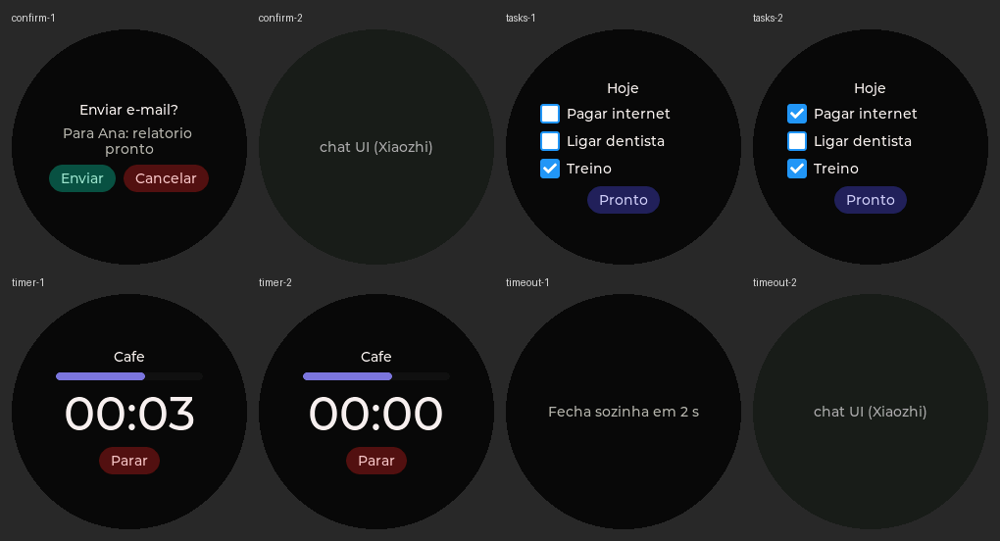

# Telas interativas: layout declarativo (Wy Glass)

O servidor desenha telas na placa mandando um **layout em JSON**, e a placa devolve os toques como eventos. Tudo passa pelo canal MCP que o Xiaozhi já usa (`type: "mcp"` no WebSocket). O protocolo não muda.

```
servidor (Gemini decide)                              placa
  tools/call self.screen.render {layout: "<json>"} ──►  desenha com LVGL por cima da interface
                                                   ◄──  result {"success": true}
                                         toque ──►
  notifications/ui_event {layout, element, event}  ◄──  
```

Código: `main/display/screen_layout.{h,cc}`. As ferramentas são registradas em `main/boards/sp-esp32-s3-1.28-box/`.

## Ferramentas MCP

| Ferramenta | Argumentos | Retorno |
| --- | --- | --- |
| `self.screen.render` | `layout` (string com o JSON abaixo) | `{"success":true}` ou `{"success":false,"error":"..."}` |
| `self.screen.close` | — | `{"success":true}` |

Um `render` novo substitui a tela aberta. Enquanto houver tela aberta, o toque vai para ela e deixa de ligar e desligar a conversa.

## Esquema do layout (versão 1)

```json
{
  "v": 1,
  "id": "confirm-email-42",
  "title": "Enviar e-mail?",
  "body": "Para Ana: relatório pronto",
  "items": [
    {"id": "t1", "text": "Pagar internet", "checked": false}
  ],
  "progress": 40,
  "timer": {"seconds": 240},
  "buttons": [
    {"id": "yes", "text": "Enviar", "style": "primary"},
    {"id": "no", "text": "Cancelar", "style": "danger"}
  ],
  "close_on_tap": true,
  "timeout_s": 10
}
```

| Campo | Tipo | Limite | Comportamento |
| --- | --- | --- | --- |
| `v` | inteiro | obrigatório, `1` | Versão do esquema; outra versão é recusada |
| `id` | string | obrigatório, até 40 caracteres | Volta em todos os eventos, para o servidor saber a qual tela o toque pertence |
| `title` | string | até 60 caracteres | Linha de destaque no topo |
| `body` | string | até 120 caracteres | Texto em cinza, quebra linha |
| `items` | lista | até 6 | Caixas de seleção; tocar alterna e gera `toggle` |
| `progress` | inteiro | 0–100 | Barra de progresso |
| `timer` | objeto | `seconds` de 1 a 5999 | Contagem regressiva em fonte grande; gera `timer_done` ao chegar em 0 |
| `buttons` | lista | até 3 | `style`: `primary` (verde), `danger` (vermelho) ou `default`; tocar gera `tap` |
| `close_on_tap` | booleano | padrão `true` | Fecha a tela depois de um toque em botão |
| `timeout_s` | inteiro | 1–600 | Fecha sozinha e gera `timeout` |

Textos maiores que o limite são cortados. Itens e botões a mais são ignorados. O layout precisa ter pelo menos um entre `title`, `body`, `items`, `progress`, `timer` e `buttons`.

A tela é redonda (240×240). Por isso o conteúdo fica numa coluna central de 170 px de largura, com margem de 35 px. Não há rolagem: o que não couber fica de fora, então mantenha as telas curtas.

## Eventos (placa → servidor)

Notificação JSON-RPC dentro de uma mensagem `type: "mcp"`:

```json
{"jsonrpc": "2.0", "method": "notifications/ui_event",
 "params": {"layout": "confirm-email-42", "element": "yes", "event": "tap"}}
```

| `event` | `element` | Extra |
| --- | --- | --- |
| `tap` | `id` do botão | — |
| `toggle` | `id` do item | `"checked": true/false` |
| `timer_done` | `"timer"` | — |
| `timeout` | `""` | — |

O evento só chega ao servidor se o canal de áudio (WebSocket) estiver aberto, ou seja, durante uma conversa. Uma tela mostrada fora de conversa funciona na placa, mas o toque não é entregue. Para confirmações isso não é problema, porque elas acontecem no meio da conversa.

## Teste no QEMU, com rede



O app `test/screen_layout_qemu/` compila o mesmo `screen_layout.cc` com a tela virtual RGB do QEMU e a Ethernet emulada (`open_eth`). Simulados ficam só o `Application` (manda o MCP pelo WebSocket) e o registro do `McpServer`. O roteiro `probes/esp32_screen_layout_qemu.py`, na raiz do repositório:
- faz o papel do servidor Xiaozhi (WebSocket em `127.0.0.1:8765`, que o QEMU enxerga como `10.0.2.2`);
- manda as telas por `tools/call`, simula toques e confere cada `notifications/ui_event`;
- tira a foto da tela pelo monitor do QEMU.

```bash
idf.py -C firmware/orb-esp32/test/screen_layout_qemu build
```
```bash
python probes/esp32_screen_layout_qemu.py --out screen-layout-shots
```

O teste precisa de janela (`-display sdl`): o driver da tela virtual espera o ciclo de atualização da janela confirmar cada desenho, e com `-display none` o firmware trava dentro de `esp_lcd_panel_draw_bitmap`.

Resultado em 2026-10-21: **12/12** verificações. O teste cobriu:
- `tools/list`;
- recusa de versão inválida;
- confirmação com toque em botão;
- lista com `toggle` e botão;
- timer com `timer_done`;
- aviso com `timeout`;
- `close`.

O teste usa só a fonte Montserrat, que não tem acentos. Por isso os textos dele estão sem acento. Na placa, o firmware usa a fonte Puhui do Xiaozhi.

## Pendente de validar na placa

- **Eixos do touch:** a tela é espelhada em X pelo driver (`DISPLAY_MIRROR_X`). Se o toque sair espelhado, mude `TOUCH_MIRROR_X` no `config.h` da placa.
- **Placas sem touch:** se o pino INT do touch estiver em nível baixo no boot, o firmware considera que a placa não tem touch e não registra a entrada. As telas aparecem, mas não recebem toque.
